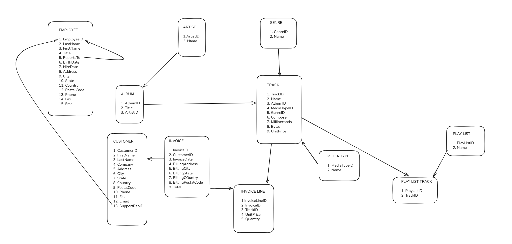

# Agent Harness From Scratch

A customer-support agent for a small online music store, built this to understand exactly how an AI agent works underneath the frameworks.

## Why this project

I had read about agents: tool calling, the agent loop, guardrails. But reading about a loop and writing one are different things. So I'm building the whole harness myself, without AI writing the code and without an agent framework, until every step is something I've written and understood:

- how a model is told which tools exist,
- how it asks for a tool, and how my code runs it,
- how results and errors go back to the model,
- and how rules in code keep the agent safe, whatever the model decides.

## What the agent does

A customer chats in the terminal. The agent:

1. identifies the customer by email,
2. lists their orders and what's inside each one,
3. searches songs by artist,
4. tells them who their support contact is,
5. changes their email address, **only after they confirm**.

## How it works

The model can only read and write text. The harness is everything around it.

```
customer message
   -> harness sends the conversation + tool descriptions to the model
   -> model asks for a tool, e.g. list_invoices
   -> harness checks the rules, runs the tool (a SQL query), sends the result back
   -> repeat until the model writes a final answer
```

## Design decisions

| Decision | Why |
|---|---|
| **The model never passes a customer ID.** After the customer is identified, the harness fills in the verified ID itself. | The model can't look up another customer's data, even if it's tricked into trying. Privacy is enforced by code, not by the prompt. |
| **Invoice ownership is checked inside the SQL** (`invoice_lines` joins `Invoice` on the customer). | An invoice that isn't yours looks exactly like one that doesn't exist. |
| **Writes are two steps: check, then apply.** `check_new_email` validates and shows old vs new; `update_email` runs only after the customer says yes, and validates again. | No data changes without a clear yes. |
| **Every query is parameterised** (`?` placeholders). | Customer input can never change the SQL (no SQL injection). |
| **Tool errors are written for the model**, e.g. "ask the customer to check the email they entered". | The model can recover and guide the customer instead of the chat crashing. |
| **Raw HTTP to the model API, no SDK** (planned). | To see exactly what goes over the wire. |

## Tools (`tools.py`)

| Tool | Answers | Returns |
|---|---|---|
| `find_customer(email)` | "Who am I?" | customer id, first name, last name, email |
| `list_invoices(customer_id)` | "What have I ordered?" | invoice id, date, total, newest first |
| `invoice_lines(customer_id, invoice_id)` | "What's in this order?" | track name, unit price, quantity |
| `search_tracks(artist)` | "What songs do you have by...?" | track, album, price (max 10) |
| `support_rep(customer_id)` | "Who's my support contact?" | rep's name and email |
| `check_new_email` / `update_email` | "Change my email" | old and new email |

## Data

The [Chinook sample database](https://github.com/lerocha/chinook-database): a music store with customers, invoices, tracks, albums, artists and employees.

**Download:** get `Chinook_Sqlite.sqlite` from the [Chinook releases page](https://github.com/lerocha/chinook-database/releases) (under Assets) and put it in this folder. The database file isn't committed here, because the tests change it.

Hand-drawn map of the tables:



The main chain most questions follow:

```
Customer -> Invoice -> InvoiceLine -> Track -> Album -> Artist
Customer -> Employee (support rep, via SupportRepId)
```

## Progress

- [x] Explore the data with plain SQL and map the schema
- [x] `tools.py`: six tools, parameterised queries, errors written for the model
- [x] Automated tests for the tools: 16 tests against answers checked by hand, each on a fresh copy of the database (`pytest`)
- [x] Tool descriptions for the model (5 of 6: each says *when* to use the tool and what comes back; `update_email` next)
- [x] One raw HTTP call to Groq with tools (`llm.py`: plain `requests`, retries on network errors, 429 and 5xx); the model replied with a `find_customer` tool call
- [x] The agent loop (`agent.py`): model → tool calls → results back → repeat, max 8 steps; the customer's ID lives in the harness's state, never in the model's hands
- [ ] Error handling: bad JSON arguments, unknown tools, tool errors and unexpected failures go back to the model ✓; LLM failures inside the loop still to do
- [ ] The confirm step for `update_email` (prepare → customer says yes → apply)
- [ ] A system prompt: what the agent is, what it can help with, "today" for the old data
- [ ] A terminal chat (`main.py`)
- [ ] Trace log and test conversations

## Setup

```
python -m venv .venv
.venv\Scripts\activate        # Windows
```

```
pip install requests python-dotenv pytest
```

Create a `.env` file (never committed) with your Groq API key:

```
GROQ_API_KEY=your-key-here
```

Run the tests with `python -m pytest` from the project folder.

